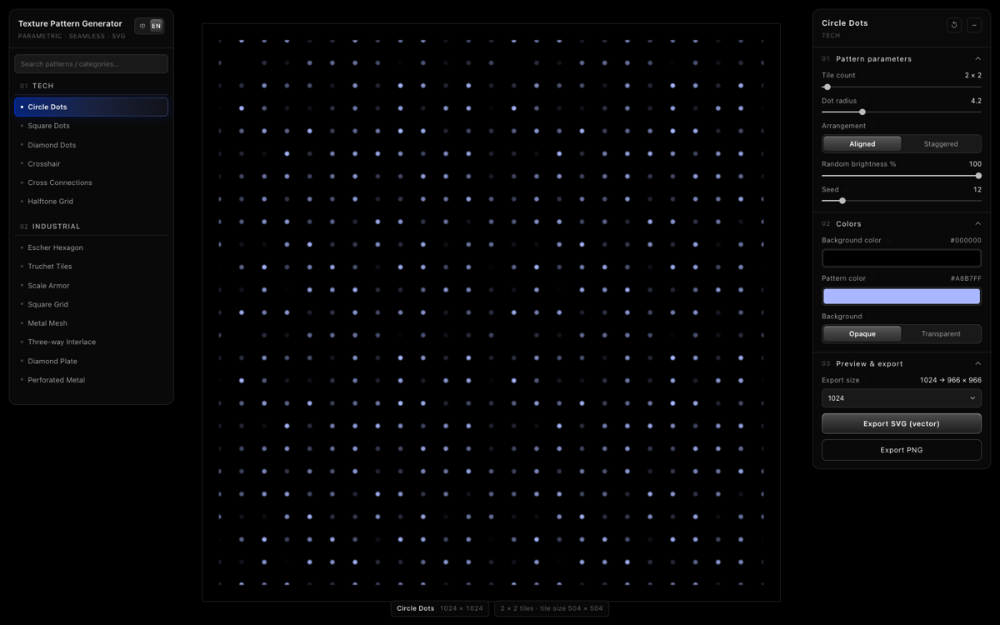
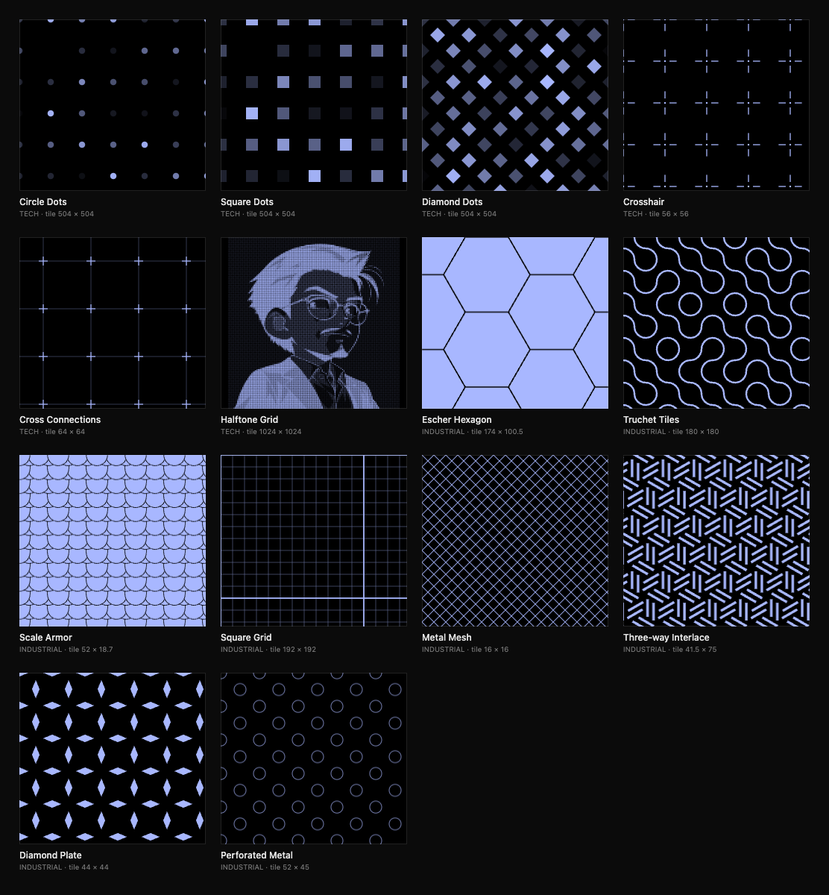

[中文](README.md) | **English**

# Texture Pattern Generator — parametric seamless vector patterns

**Parametric · seamless · vector.** A pure front-end tool with zero dependencies and no external links — the whole app is **one HTML file** (about 140 KB). Double-click to open it, or send it to someone and it still works offline.

**Online demo**: <https://afeiisfine.github.io/texture-pattern-generator/> · **Single file**: download [`index.html`](index.html) and double-click it

> **A note from the author**
>
> I don't know how to program. Every line of code, every feature — and this document — was written by AI. Please forgive any amateurish mistakes.

## What it is

A **parametric pattern generator** for graphic design assets and 3D textures: 14 procedural patterns, each with live parameters and two colors. The preview always shows a **whole number of complete tiles**, so whatever you export tiles seamlessly in any vector application.

This tool is deliberately about **vector + live parameters + seamless tiling** — not photoreal bitmap materials (for brushed metal, carbon fibre and the like, a CC0 material library is the better answer).

## Two ways to open it

| Way | How | Good for |
|---|---|---|
| **Single file** | Download [`index.html`](index.html) and double-click it — or grab `texture-pattern-generator.html` from [Releases](https://github.com/AfeiIsFine/texture-pattern-generator/releases/latest) (same file, friendlier name) | Sharing / offline use — one file, no server, no network |
| **Online** | Open <https://afeiisfine.github.io/texture-pattern-generator/> | Just see it, no download |

Both use the same file — there is no build step; `index.html` contains all the code (including the embedded default sample image).

> **Verified as a true single file**: copy just `index.html` into an empty folder and open it directly in the browser (`file://`, i.e. double-click) — all 14 patterns, the Chinese/English switch and SVG / PNG export work, even with **the network turned off**. Measured **0 http(s) requests** during load.

## The 14 patterns

*All 14 patterns at a glance: six Tech, eight Industrial. Each is seamlessly tileable — every tile works on its own too.*

**Tech**

| Pattern | 中文 | Notes |
|---|---|---|
| Circle Dots | 圆形点阵 | Round dots on a grid or staggered lattice; random brightness turns it into a light/dark mosaic |
| Square Dots | 方形点阵 | Square dots, bolder block feel |
| Diamond Dots | 菱形点阵 | Diamond lattice with a diagonal rhythm |
| Crosshair | 十字准星 | Cross lines plus a centre dot — instrument-scale look |
| Cross Connections | 十字点线 | Cross lattice with an optional connecting layer (lines or dots), dimmable separately |
| Halftone Grid | 半调网格 | Upload an image → vector halftone dots, output follows the image aspect ratio |

**Industrial**

| Pattern | 中文 | Notes |
|---|---|---|
| Escher Hexagon | 埃舍尔六角 | Hexagons share one displacement curve along all three edge pairs, interlocking; C3 / C6 symmetry |
| Truchet Tiles | Truchet 瓷砖 | Two quarter arcs per cell — random / diagonal / aligned; optional light/dark alternation |
| Scale Armor | 铠甲鳞片 | Overlapping fish-scale paving, adjustable dome curvature and row height |
| Square Grid | 方格网 | Thin grid plus major grid, brightness adjustable for each layer |
| Metal Mesh | 金属网 | Diagonal metal mesh with an industrial stamped feel |
| Three-way Interlace | 三向交错 | Short bars in three directions (30° / 90° / 150°) interlaced on a triangular lattice |
| Diamond Plate | 钻石防滑纹 | Diamond tread plate, outline or solid |
| Perforated Metal | 冲孔金属 | Round-hole perforated sheet — square or staggered hex layout, outline or solid |

## UI and controls

- **Pattern library** on the left: search matches Chinese name, English name and pattern id (e.g. `hex`, `六角`)
- **Tile count** is the only "zoom" control — it decides how many complete tiles fill the canvas; the HUD below the canvas shows `N × M tiles`
- **Every parameter has a ↺**: it appears when you hover the label, and is dimmed while at its default — zero cost to experiment
- **Chinese / English switch** next to the panel title: pattern names, parameter labels, options and tooltips all switch; the choice is remembered
- Shortcuts: `H` hide / show panels · `0` restore the recommended tile count · `+` / `-` change tile count · mouse wheel works too

## Colours

- Only two colours: **background** and **pattern**, plus an optional **transparent background** (PNG keeps the alpha channel)
- Where light/dark layering is needed (random brightness, connecting layers, Truchet alternation) it is done with the pattern colour at reduced opacity — no third accent colour
- Switching patterns keeps your colours; each pattern remembers its own parameters

## Export

- **SVG (vector)**: a whole number of complete tiles; the boundary falls exactly on tile edges. Tiling is built with `<use>` + `<clipPath>` (opens correctly in Affinity too — verified pixel-identical to the browser render)
- **PNG (bitmap)**: rasterised from the same SVG; choosing 1024 gives roughly **966 × 966**, because the 3% preview margin is not part of the export (that is what makes the boundary seamless)
- File names: `texture-<pattern id>-<width>x<height>.svg` / `.png`

## Browser and privacy

- Modern Chrome / Edge / Safari / Firefox; the UI is designed as a desktop tool and narrows its panels on small screens
- **No network, no analytics, no server**: everything runs in your browser; uploaded images are processed in a local canvas and never leave your machine. The only http string in the file is the SVG namespace identifier (`http://www.w3.org/2000/svg`), which never triggers a request
- Parameters and language preference live in localStorage (`ttl.prefs.v1` / `ttl.lang`); clearing site data restores defaults. The language choice is kept **within the same browser profile** (another browser or a private window starts in Chinese)

## Code layout

- The source is just [`index.html`](index.html) — no build, no dependencies: the tool-UI CSS at the top, the 14 tile generators in the middle, UI and export logic at the bottom
- Pattern interface: each pattern's `tile(P, C)` returns a seamlessly tiling unit (SVG string + size); its `params` array declares the controls, which the UI generates automatically
- English copy lives in two objects, `I18N` (UI) and `PAT_I18N` (pattern names / parameters / options), so translating never touches the pattern code

## License

[MIT](LICENSE) — free to use commercially, modify and redistribute; keep the copyright notice.
