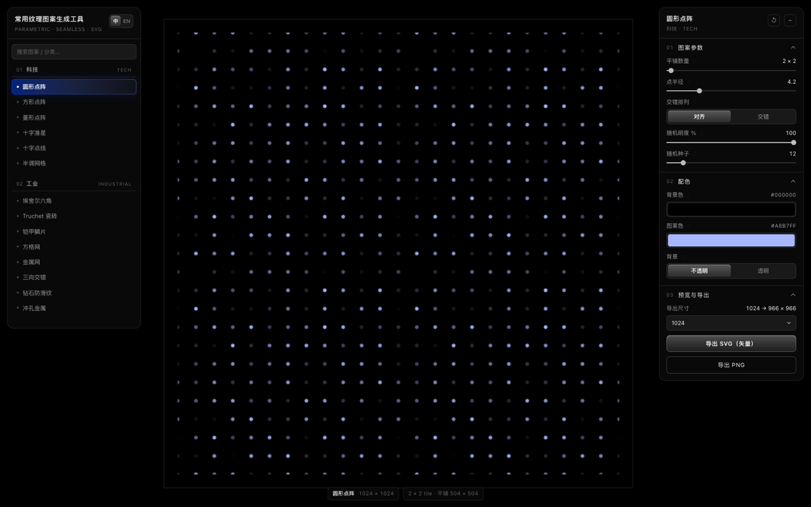
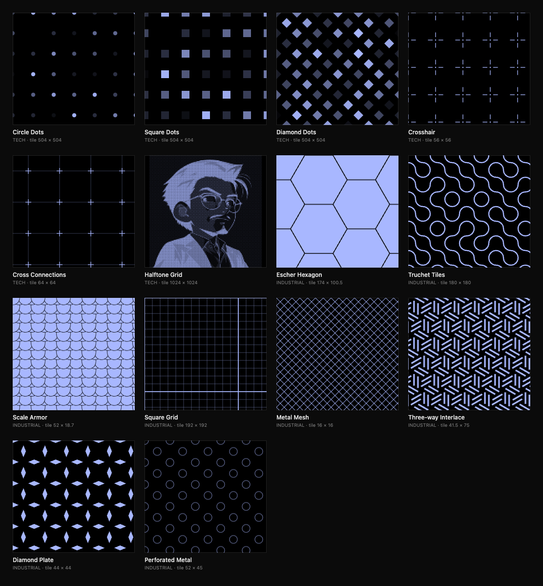

**中文** | [English](README.en.md)

# 常用纹理图案生成工具 · Texture Pattern Generator

**参数化 · 四方连续 · 矢量图案生成器。** 纯前端、零依赖、无外链 —— 整个工具就是**一个 HTML 文件**（约 140 KB），双击即用，也可以离线发给别人。

**[在线试用](https://afeiisfine.github.io/texture-pattern-generator/)** · **单文件版**：下载 [`index.html`](index.html) 双击打开

> **关于作者**
>
> 本项目作者完全不懂开发，所有代码、功能都是 AI 写的，包括这份说明文档。如果有低级错误，请见谅。

## 这是什么

给平面设计素材和 3D 贴图用的**参数化图案生成器**：14 个程序化图案，每个都能实时调参、换色；预览始终显示**整数个完整平铺单元**，导出的文件在任何矢量软件里都能无缝平铺。

定位很直接：本工具做的是**矢量 + 参数实时可调 + 四方连续**，不是写实位图材质（拉丝金属、碳纤维那类，用 CC0 材质库更合适）。

## 两种打开方式

| 方式 | 怎么做 | 适合 |
|---|---|---|
| **单文件版** | 下载 [`index.html`](index.html) 双击打开；想用更干净的文件名，也可以从 [Releases](https://github.com/AfeiIsFine/texture-pattern-generator/releases/latest) 下载 `texture-pattern-generator.html`（同一份文件） | 发给别人 / 离线用；整个工具就一个文件，不需要服务器、不需要联网 |
| **在线版** | 打开 <https://afeiisfine.github.io/texture-pattern-generator/> | 不下载，直接看效果 |

两种方式用的是同一份文件 —— 本工具没有构建步骤，`index.html` 里就是全部代码（内嵌默认示例图），改完刷新即可。

> **已验证的单文件性**：只把 `index.html` 一个文件拷到空目录、在浏览器里直接打开（`file://`，等价于双击），14 个图案、中英切换、导出 SVG / PNG 全部正常；**断网也能用**。加载期实测 **0 个 http(s) 请求**。

## 14 个图案

*14 个图案的总览：上 6 个是科技类，下 8 个是工业类。都是四方连续 —— 每个 tile 单独拿出来也能无缝拼接。*

**科技 / Tech**

| 图案 | English | 要点 |
|---|---|---|
| 圆形点阵 | Circle Dots | 圆形点按网格 / 交错排布；随机明度可做明暗马赛克 |
| 方形点阵 | Square Dots | 方形点阵，块面感更强 |
| 菱形点阵 | Diamond Dots | 菱形点阵，斜向节奏 |
| 十字准星 | Crosshair | 十字线 + 中心圆点，仪器刻度感 |
| 十字点线 | Cross Connections | 十字点阵，可选连线 / 圆点两种连接层，明度分开可压 |
| 半调网格 | Halftone Grid | 上传图片 → 矢量半调网点，按图片比例输出 |

**工业 / Industrial**

| 图案 | English | 要点 |
|---|---|---|
| 埃舍尔六角 | Escher Hexagon | 六边形三组对边共用位移曲线，互相咬合；C3 / C6 对称 |
| Truchet 瓷砖 | Truchet Tiles | 每格两条四分之一圆弧，随机 / 对角 / 同向；明暗交替 |
| 铠甲鳞片 | Scale Armor | 鱼鳞式重叠铺砌，弧顶曲率与行高可调 |
| 方格网 | Square Grid | 细线 + 主格线双层网格，两层明度分开可调 |
| 金属网 | Metal Mesh | 斜向金属网，工业冲压感 |
| 三向交错 | Three-way Interlace | 三组朝向（30° / 90° / 150°）短棒在三角格点上交错 |
| 钻石防滑纹 | Diamond Plate | 钻石防滑钢板，线框 / 实心两种模式 |
| 冲孔金属 | Perforated Metal | 圆孔冲孔板，方形 / 六角错排、线框 / 实心 |

## 界面与操作

- **左栏图案库**：搜索框同时匹配中文名、英文名与图案 id（如 `hex`、`六角`）
- **平铺数量**：唯一的「缩放」控制 —— 决定画面里铺几个完整 tile；画面下方显示当前 `N × M tile`
- **每个参数都有 ↺**：悬停参数名才显形，已在默认值时变淡且不可点，试错成本为零
- **中 / 英切换**：左栏标题旁「中 / EN」，切换覆盖图案名、参数标签、选项与提示；偏好会记住
- 快捷键：`H` 收起 / 显示面板 · `0` 恢复推荐平铺数 · `+` / `-` 增减平铺数 · 滚轮也可增减

## 配色

- 只有两个颜色：**背景色**与**图案色**，另可选**透明背景**（导出 PNG 保留 alpha）
- 需要明暗层次的地方（随机明度点阵、连线层、Truchet 交替）用「图案色 + 透明度」做，不额外引入强调色
- 换图案时配色保留；每个图案的参数各自独立记忆

## 导出

- **SVG（矢量）**：整数个完整 tile，边界严格落在 tile 边界上；平铺用 `<use>` + `<clipPath>` 实现（Affinity 打开也不会空白，实测与浏览器渲染逐像素一致）
- **PNG（位图）**：由同一份 SVG 光栅化；选 1024 时实际输出约 **966 × 966**（预览四周 3% 留白不进入导出，换来边界无缝）
- 文件名：`texture-<图案 id>-<宽>x<高>.svg` / `.png`

## 浏览器与隐私

- Chrome / Edge / Safari / Firefox 现代版本可用；界面按桌面工具设计，窄屏会自动收窄面板
- **不联网、无统计、无服务器**：所有计算都在浏览器里；图片上传只在本机 canvas 中处理，不会被发送到任何地方。文件里唯一出现的 http 字符串是 SVG 命名空间标识（`http://www.w3.org/2000/svg`），不会发起网络请求
- 参数与语言偏好存在浏览器 localStorage（`ttl.prefs.v1` / `ttl.lang`），清缓存即恢复默认；语言偏好在**同一浏览器配置**内保持（换浏览器 / 隐身窗口回到默认中文）

## 代码结构

- 源码就是 [`index.html`](index.html) 一个文件（无构建、无依赖）：顶部是工具类 UI 的 CSS，中间是 14 个图案的 tile 生成函数，底部是界面与导出逻辑
- 图案接口：每个图案的 `tile(P, C)` 返回一个四方连续平铺单元（SVG 字符串 + 尺寸），参数由 `params` 声明，界面自动生成控件
- 英语词条集中在 `I18N`（界面）与 `PAT_I18N`（图案名称 / 参数 / 选项）两个对象里，改文案不用动图案代码

## License

[MIT](LICENSE) —— 可商用、可修改、可再分发，保留版权声明即可。
